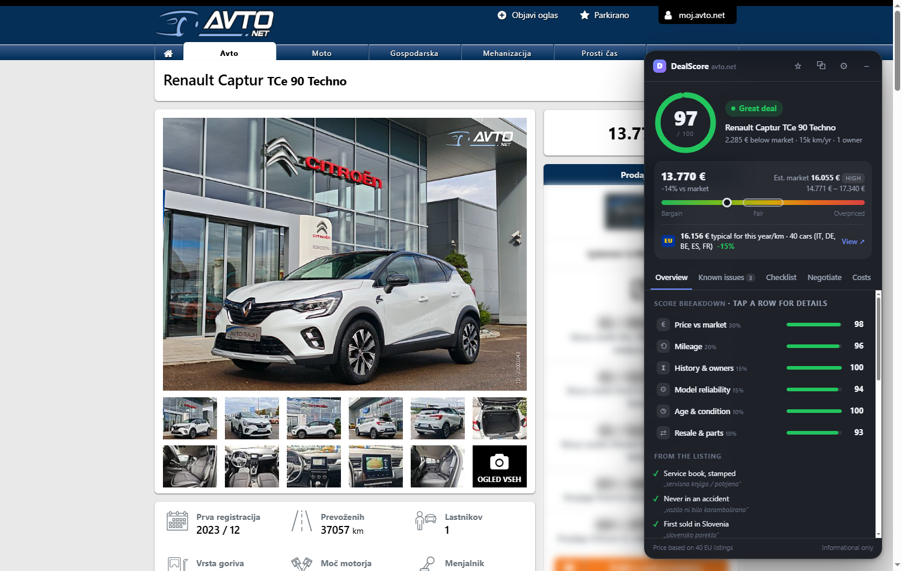
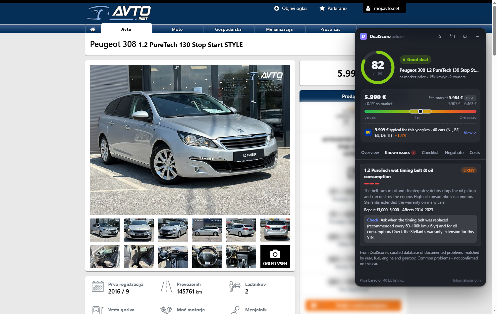
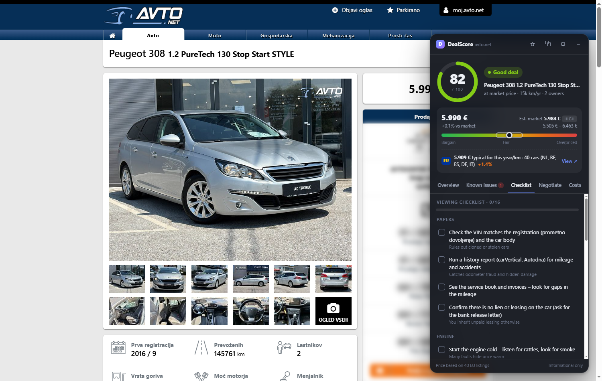
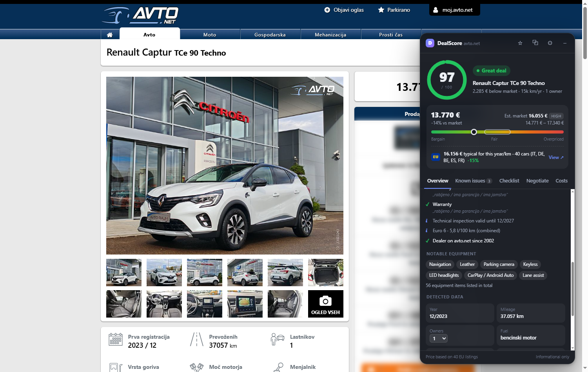
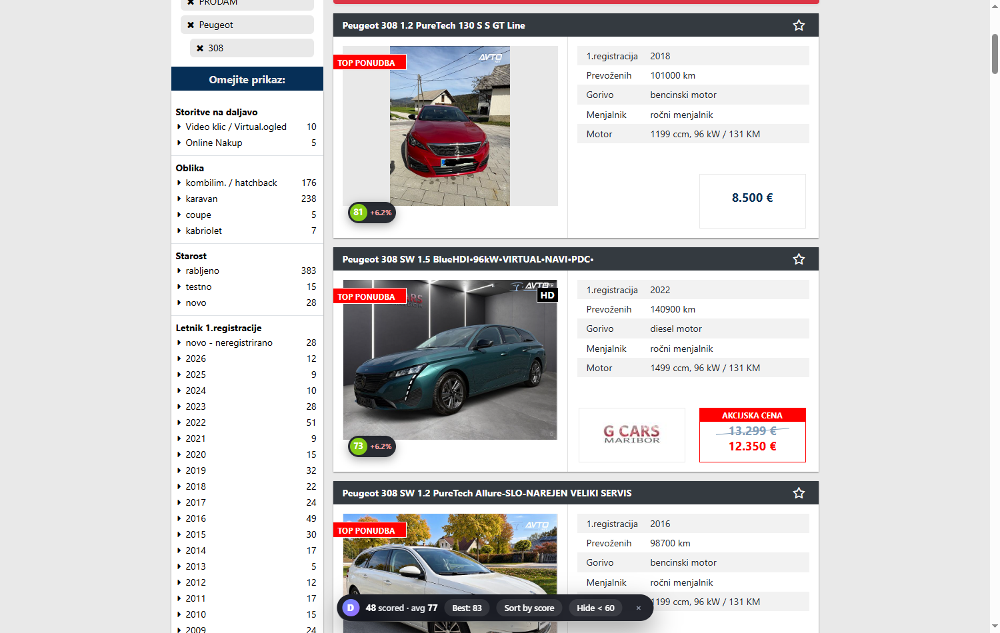
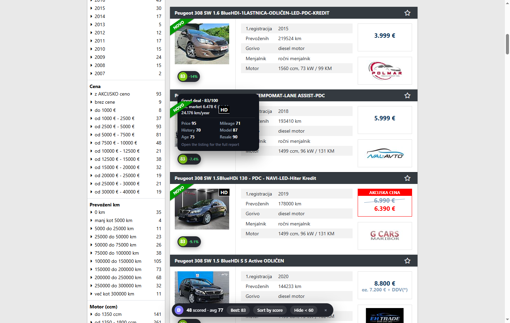
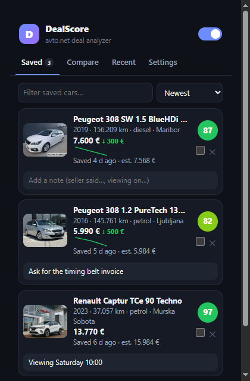
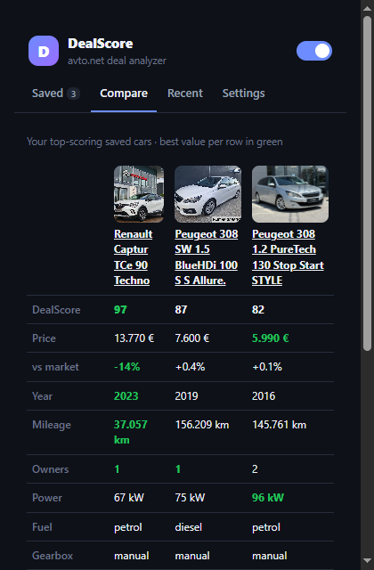
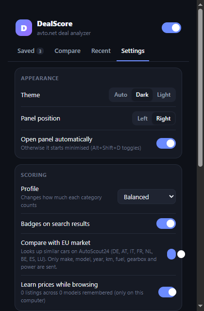

# DealScore – Car Deal Analyzer for avto.net

A Chrome/Edge extension that tells you whether a used car on [avto.net](https://www.avto.net) is a good deal and what to check before you buy it.



## Features

| | |
|---|---|
| **0–100 deal score** | Weighted from six categories: price vs market, mileage, history & owners, model reliability, age & condition, and resale & parts. Choose a profile (Balanced, Bargain hunter, Reliability first, Resale value). |
| **EU market comparison** | Looks up comparable cars on AutoScout24 in DE, AT, IT, FR, NL, BE, ES and LU (same model, fuel and gearbox, ±1 year, similar km and power). Shows the typical EU price for that year and mileage, with a link to the listings. |
| **Market price estimate** | Blends EU listings, avto.net prices learned while you browse search results, and rough reference data. The confidence label (low/medium/high) shows how much data it's based on. |
| **From the listing** | Shows what the listing actually says: the seller's ticked condition boxes, quotes from their comment, warranty, inspection date and notable equipment. Each is quoted in Slovene with its English meaning. |
| **Known issues** | A curated database of documented problems covering 380+ models and 28 brands (PureTech wet belt, BMW N47 timing chain, VW DQ200 DSG, Renault 1.2 TCe oil burning, Ingenium oil dilution, Subaru boxer-diesel crankshaft…). Each is matched to the car's **year, fuel, engine size and gearbox** and marked *likely* or *possible*, with repair cost and what to check. Shared engines are recognised across brands (e.g. BMW's N47 in Toyotas, Renault's 1.5 dCi in Mercedes, PSA's 1.6 diesel in Volvo/Ford/Mazda), so models not listed by name still get their engine's problems. In a test on 700 live avto.net listings, 98% got known-issue data. Positive notes are shown too (e.g. the 1.2 PureTech switched to a timing chain from 2024). When nothing documented matches, the panel says so instead of showing generic filler. |
| **Red-flag detection** | Reads the Slovene listing text for accidents, faults, paperwork problems and imports. It understands negation ("vozilo **ni bilo** karambolirano" is a positive), matches whole words only ("istočasno" is not "toča"), and ignores dealer service ads. Serious flags cap the score; scratches and dents are a minor note. |
| **Inspection checklist** | Tailored to fuel type, gearbox, mileage and known issues. Your ticks are saved per listing. |
| **Ask the seller** | A ready-to-send message in Slovene with the right questions for this car, plus an English translation. |
| **Negotiation plan** | Opening offer, target and walk-away price, with each argument priced in €, including EU prices when they're lower. |
| **Running costs** | Yearly fuel, insurance, registration, maintenance and value loss, using your own km/year and fuel prices. |
| **Results badges** | Every listing in search results, promoted ones included, gets a score badge with a hover breakdown, plus *Sort by score*, *Jump to best* and *Hide < 60*. |
| **Watchlist & price tracking** | Save cars with ☆. DealScore records price changes each time you see them again and shows drops with sparklines. |
| **Compare** | Up to three saved cars side by side, with the best value in each row highlighted. |
| **Quality of life** | Dark/light/auto theme, draggable panel, minimise to a pill, `Alt+Shift+D` toggle, toolbar badge with the score, JSON backup/restore. |

## Screenshots

Taken on real avto.net listings (October 2026). Seller names, phone numbers, e-mails and addresses are blurred.

**Listing panel.** A 2016 Peugeot 308 1.2 PureTech: the engine's known wet-belt problem is flagged as *likely*, the price matches 40 comparable EU listings, and the negotiation plan uses both.

| Known issues | Negotiation |
|---|---|
|  |  |
| **Checklist** | **Running costs** |
|  |  |

**From the listing.** The seller's own condition boxes and equipment, translated (2023 Renault Captur, 15% below the EU median).



**Search results.** Score badges with a hover breakdown, and the toolbar for sorting and filtering.

| Badges | Sorted by score |
|---|---|
|  |  |

**Popup.** Watchlist, compare and settings. The notes and price history in the watchlist are example data.

| Watchlist | Compare | Settings |
|---|---|---|
|  |  |  |

## Install (developer mode)

1. Download or clone this repository.
2. Open `chrome://extensions` (or `edge://extensions`).
3. Turn on **Developer mode**.
4. Click **Load unpacked** and select the repository folder.
5. Open any listing on avto.net, e.g. `https://www.avto.net/Ads/details.asp?id=...`.

After pulling a new version, click **Reload** (↻) on the extension's card in `chrome://extensions`. Otherwise the browser keeps running the old background worker.

## How scoring works

Each category scores 0–100. The overall score is their weighted average:

| Category | Balanced weight | What it looks at |
|---|---|---|
| Price vs market | 30% | Asking price vs estimate (pulled toward neutral when the estimate is uncertain). |
| Mileage | 20% | km/year for the age, total km, odometer-rollback hints, diesel short-trip use. |
| History & owners | 15% | Owner count, service book, warranty, imports, damage wording. |
| Model reliability | 15% | Curated known issues weighted by severity, and whether they match this engine. |
| Age & condition | 10% | Age, technical inspection validity, Euro class, garage-kept, rust mentions. |
| Resale & parts | 10% | How many are registered in Slovenia (parts, mechanics, resale speed). |

Caps: accident/damage wording caps the score at 45, "faulty / not drivable" at 35. A likely engine-threatening known issue limits the score to 82 until the seller proves it was fixed.

Verdicts: **Great deal** 85+, **Good deal** 72+, **Fair** 58+, **Caution** 42+, **Risky** below 42.

### Market estimate

Three sources are blended, each comparable adjusted to the car's year and mileage:

1. **EU listings (AutoScout24).** Up to 40 comparable cars, found by the background worker and cached for 12 hours. Filters loosen step by step (power, then km, then gearbox) until at least 5 matches are found.
2. **Learned avto.net prices.** Every search-results page you view is remembered locally as comparables for that model.
3. **Reference data** (`marketPrices.json`). A rough price per model on a depreciation curve. Only a weak fallback, always *low* confidence.

The more comparables, the higher the confidence and the narrower the fair-price range. A price far below a well-supported estimate caps the score at 70 (possible scam or hidden damage).

## Project layout

```
manifest.json            MV3 manifest
src/lib/                 shared logic (also runs in Node for tests)
  util.js data.js        helpers, DB loading and make/model matching
  market.js              price estimate
  scoring.js             categories, text rules, verdicts
  insights.js            checklist, negotiation, costs, seller message
  parser.js              avto.net detail + results page parsing
  eu.js                  AutoScout24 search URLs + result parsing (EU comparison)
  store.js               chrome.storage (settings, watchlist, comps, history)
src/data/knownIssues.js  curated engine/year-aware problem database
src/content/             details.js (panel), results.js (badges)
src/ui/                  panel.css (shadow DOM), results.css
src/popup/               watchlist, compare, recent, settings, welcome
src/background.js        toolbar badge, keyboard command, EU lookup + cache
issues.json              generic fallback issue list
marketPrices.json        reference prices
popularity.json          registered cars per model in Slovenia (built from carDB/)
tests/                   unit tests + HTML fixtures mirroring avto.net markup
```

## Development

```bash
npm test
```

- `tests/fixtures/details.html` and `tests/fixtures/results.html` mirror avto.net's markup and load the content scripts with a stubbed `chrome` API. Open them in a browser started with `--allow-file-access-from-files` to work on the UI without hitting avto.net.
- `npm run build:popularity` rebuilds `popularity.json` from `carDB/slovenia_car_db_final.json`. The old `sloveniaPopularity.json` lost every model with digits in its name.
- To add a known problem, edit `src/data/knownIssues.js`. Filter it with `y`, `fuel`, `gear`, `eng`/`ccm` so it only matches the affected cars.

## Ideas for next versions

- Support more sites (bolha.com, mobile.de, willhaben.at) by adding a parser per site.
- VIN lookup links (carVertical/Autodna) prefilled from the listing.
- Price-drop notifications for saved cars, using a periodic background check.
- Photo checks (stock photos, number plates hidden, photos reused across listings).
- Leasing/credit calculator next to the negotiation plan.

## Privacy

Settings, watchlist, checklist ticks and learned prices are stored only in your browser (`chrome.storage`).

The **EU market comparison** is the one feature that makes a network request: it sends a search to autoscout24.com with the car's make, model, year range, km range, fuel, gearbox and power. Nothing about you or the listing's seller is sent. It can be switched off in Settings.

## Disclaimer

DealScore is informational only. Scores and known issues are heuristics, not a guarantee about any specific car. Always get a pre-purchase inspection.
