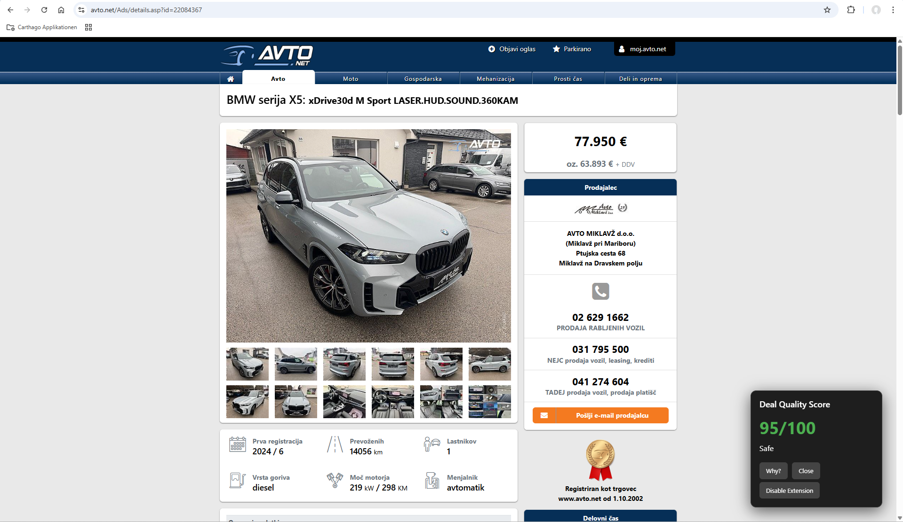

# Car Deal Safety Score Browser Extension

## What It Does
This Chrome/Edge extension analyzes used car listings on avto.net and overlays a "Deal Quality Score" to help you assess if it's a safe buy. It uses only data visible on the page (price, year, mileage, owners, etc.) and applies heuristic rules to compute a score from 0-100.

## How Scoring Works
- **Base Score**: Starts at 100.
- **Price vs Market**: Compares to mocked average prices. Deducts for over/under pricing.
- **Mileage Risk**: Checks km/year for high/low usage.
- **Ownership Risk**: Deducts for multiple owners.
- **Model Risks**: Deducts for known issues in popular models.
- **Verdict**: Safe (80+), Caution (60-79), Risky (<60).

## How to Install (Developer Mode)
1. Download the extension folder.
2. Go to `chrome://extensions/` (or Edge equivalent).
3. Enable "Developer mode".
4. Click "Load unpacked" and select the folder.
5. Visit an avto.net listing like https://www.avto.net/Ads/details.asp?id=XXXX.

To disable: Use the "Disable Extension" button in the overlay (uses localStorage).

## Limitations
- Only works on avto.net detail pages.
- Mocked market prices (not real-time).
- Limited model database.
- May fail if site structure changes (update selectors in content.js).
- No support for other sites yet.

## Disclaimer
This score is informational only, based on heuristics and visible data. It is not financial advice or a purchase guarantee. Always consult a mechanic and verify details independently. No data is stored or sent anywhere.
## Delete after complete
All databases from excell delte them these are 

agregate_models.py
agregated_car_db.json
agregate_to_dic.py
popularity_dict.json
slovenia_car_db.json
vozila_to_json.py
generate_issues_skeleton.py
