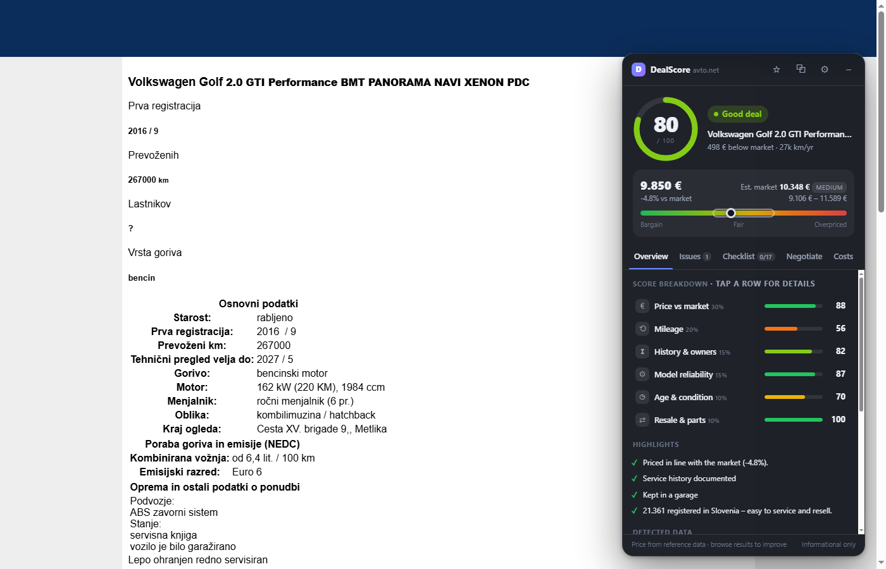
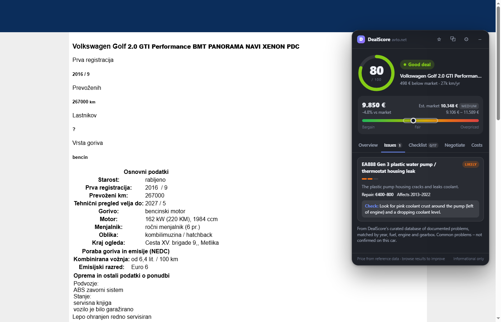
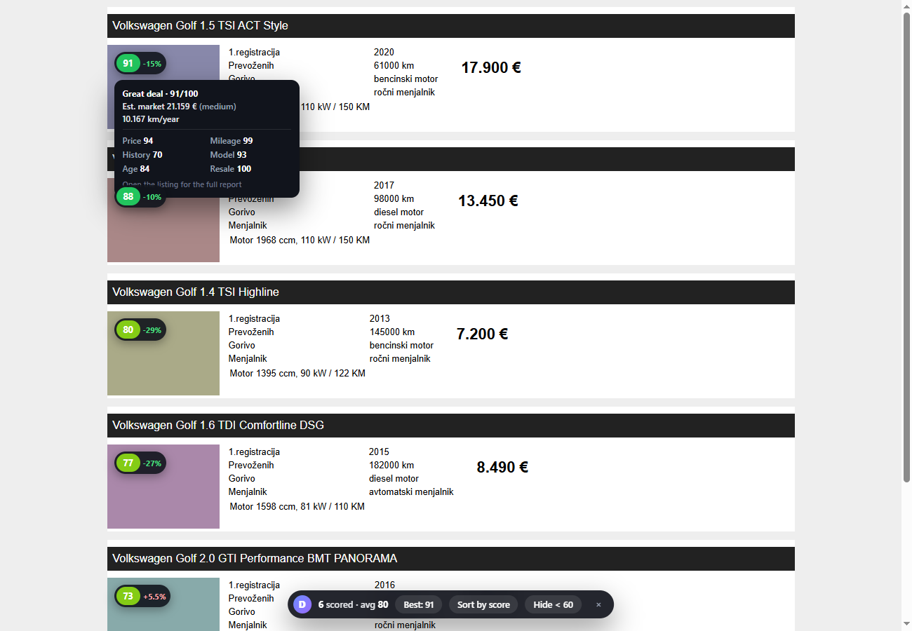

# DealScore – Car Deal Analyzer for avto.net

A Chrome/Edge extension that tells you whether a used car on [avto.net](https://www.avto.net) is a good deal and what to check before you buy it.



## Features

| | |
|---|---|
| **0–100 deal score** | Weighted from six categories: price vs market, mileage, history & owners, model reliability, age & condition, and resale & parts. Choose a profile (Balanced, Bargain hunter, Reliability first, Resale value). |
| **Market price estimate** | Shows a fair-price range with a bar marking where the asking price sits. The estimate starts from reference data and improves as you browse, because every search-results page teaches DealScore real asking prices. |
| **Real known problems** | A curated database of 100+ documented problems across 125 models (PureTech wet belt, BMW N47 timing chain, VW DQ200 DSG, Renault 1.2 TCe oil burning, Mazda 2.2D oil dilution…). Each is matched to the car's **year, fuel, engine size and gearbox** and comes with a repair cost and what to check. |
| **Red-flag detection** | Reads the listing text (Slovene) for accidents (*karambolirano*), faults, imports, service history, warranty and more. Serious flags cap the score. |
| **Inspection checklist** | Tailored to fuel type, gearbox, mileage and known issues. Your ticks are saved per listing. |
| **Ask the seller** | A ready-to-send message in Slovene with the right questions for this car, plus an English translation. |
| **Negotiation plan** | Opening offer, target and walk-away price, with each argument priced in €. |
| **Running costs** | Yearly fuel, insurance, registration, maintenance and value loss, using your own km/year and fuel prices. |
| **Results badges** | Every listing in search results gets a score badge with a hover breakdown, plus *Sort by score*, *Jump to best* and *Hide < 60*. |
| **Watchlist & price tracking** | Save cars with ☆. DealScore records price changes each time you see them again and shows drops with sparklines. |
| **Compare** | Up to three saved cars side by side, with the best value in each row highlighted. |
| **Quality of life** | Dark/light/auto theme, draggable panel, minimise to a pill, `Alt+Shift+D` toggle, toolbar badge with the score, JSON backup/restore. |

 



## Install (developer mode)

1. Download or clone this repository.
2. Open `chrome://extensions` (or `edge://extensions`).
3. Turn on **Developer mode**.
4. Click **Load unpacked** and select the repository folder.
5. Open any listing on avto.net, e.g. `https://www.avto.net/Ads/details.asp?id=...`.

## How scoring works

Each category scores 0–100. The overall score is their weighted average:

| Category | Balanced weight | What it looks at |
|---|---|---|
| Price vs market | 30% | Asking price vs estimate (pulled toward neutral when the estimate is uncertain). |
| Mileage | 20% | km/year for the age, total km, odometer-rollback hints, diesel short-trip use. |
| History & owners | 15% | Owner count, service book, warranty, imports, damage wording. |
| Model reliability | 15% | Curated known issues weighted by severity, and whether they match this engine. |
| Age & condition | 10% | Age, technical inspection validity, Euro class, garage-kept, rust mentions. |
| Resale & parts | 10% | How many are registered in Slovenia (parts, mechanics, resale speed). |

Caps: accident/damage wording caps the score at 45, "faulty / not drivable" at 35. A likely engine-threatening known issue limits the score to 82 until the seller proves it was fixed.

Verdicts: **Great deal** 85+, **Good deal** 72+, **Fair** 58+, **Caution** 42+, **Risky** below 42.

### Market estimate

1. **Reference data** (`marketPrices.json`): one price per model, projected to the car's year with a depreciation curve and adjusted for mileage. The table runs high, so it is scaled by a calibration factor (see `src/lib/market.js`).
2. **Learned comparables**: prices of listings you've seen on results pages (stored only in your browser). With 3+ comparables of the same model (±2 years) they take over most of the estimate, and the confidence label rises to *medium/high*.

## Project layout

```
manifest.json            MV3 manifest
src/lib/                 shared logic (also runs in Node for tests)
  util.js data.js        helpers, DB loading and make/model matching
  market.js              price estimate
  scoring.js             categories, text rules, verdicts
  insights.js            checklist, negotiation, costs, seller message
  parser.js              avto.net detail + results page parsing
  store.js               chrome.storage (settings, watchlist, comps, history)
src/data/knownIssues.js  curated engine/year-aware problem database
src/content/             details.js (panel), results.js (badges)
src/ui/                  panel.css (shadow DOM), results.css
src/popup/               watchlist, compare, recent, settings, welcome
src/background.js        toolbar badge, keyboard command
issues.json              generic fallback issue list
marketPrices.json        reference prices
popularity.json          registered cars per model in Slovenia (built from carDB/)
tests/                   unit tests + HTML fixtures mirroring avto.net markup
```

## Development

```bash
npm test
```

- `tests/fixtures/details.html` and `tests/fixtures/results.html` mirror avto.net's markup and load the content scripts with a stubbed `chrome` API. Open them in a browser started with `--allow-file-access-from-files` to work on the UI without hitting avto.net.
- `npm run build:popularity` rebuilds `popularity.json` from `carDB/slovenia_car_db_final.json`. The old `sloveniaPopularity.json` lost every model with digits in its name.
- To add a known problem, edit `src/data/knownIssues.js`. Filter it with `y`, `fuel`, `gear`, `eng`/`ccm` so it only matches the affected cars.

## Ideas for next versions

- Support more sites (bolha.com, mobile.de, willhaben.at) by adding a parser per site.
- A shared, anonymous price index so estimates are good from day one.
- VIN lookup links (carVertical/Autodna) prefilled from the listing.
- Price-drop notifications for saved cars, using a periodic background check.
- Photo checks (stock photos, number plates hidden, photos reused across listings).
- Leasing/credit calculator next to the negotiation plan.

## Privacy

Everything runs locally in your browser. Settings, watchlist and learned prices are stored with `chrome.storage`. Nothing is sent anywhere.

## Disclaimer

DealScore is informational only. Scores and known issues are heuristics, not a guarantee about any specific car. Always get a pre-purchase inspection.
